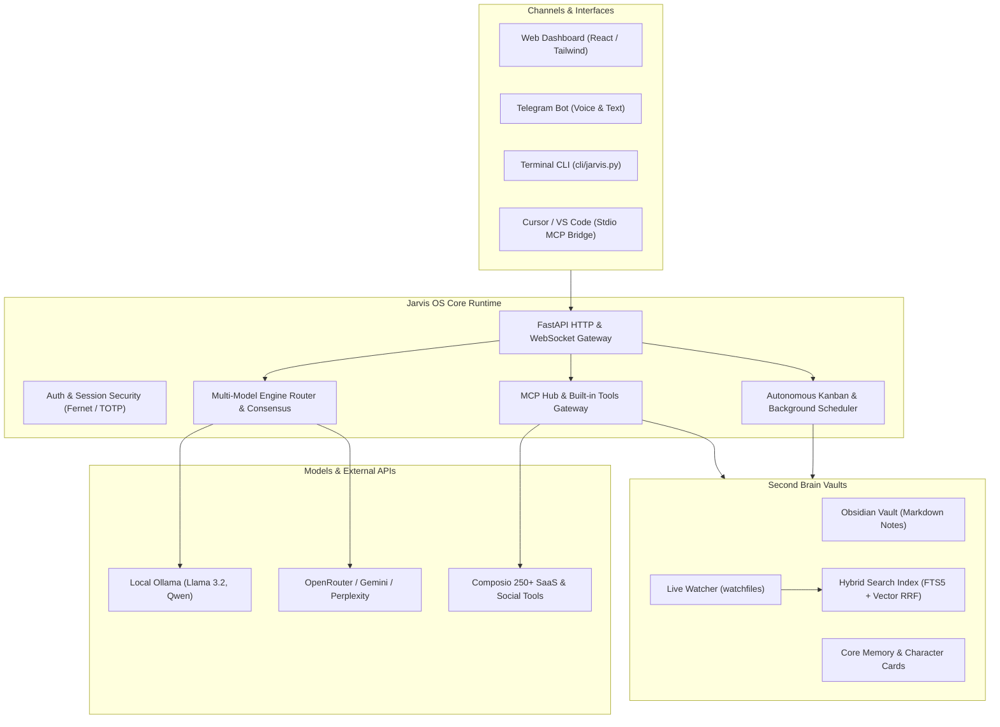

# Jarvis OS

> **Self-Hosted Personal Agentic Operating System & Second Brain**

Jarvis OS is an autonomous personal AI operating system designed for software engineers, researchers, and creators. It unifies multi-model reasoning, an Obsidian-compatible Second Brain, background task orchestration, Model Context Protocol (MCP) integrations, and cross-channel communication into a single private self-hosted stack.

---

## Key Highlights

- **Swappable Multi-Model Intelligence:** Seamlessly switch or debate across Google Gemini, OpenRouter, Perplexity, Qwen, Kimi, local Llama (via Ollama), and CLI subscription adapters (Codex & Antigravity).
- **Multi-Model Consensus & Debate:** Parallel model querying (`jarvis_consensus`) and multi-turn adversarial debates (`jarvis_debate`) for verifying complex technical trade-offs.
- **Obsidian-Compatible Second Brain:** Pure Markdown notes (`memory/`, `wiki/`, `sources/`, `agents/`, `skills/`, `workflows/`) with automated Git version control.
- **Hybrid Semantic Search (RAG):** Combines SQLite FTS5 BM25 keyword matching and 384-dimensional dense vector embeddings with Reciprocal Rank Fusion (RRF).
- **Live Obsidian Watcher:** Rust-backed file monitoring (`watchfiles`) that automatically synchronizes, indexes, and auto-commits external edits from Obsidian or VS Code in real time.
- **Core Memory (Letta / MemGPT Style):** Dynamic, self-editing memory blocks (`User Profile`, `Persona`, `Context & Goals`) that Jarvis updates autonomously across sessions.
- **Brain Character Cards:** Dedicated persona profiles (`memory/CHARACTER.md`) with ready-made presets: Chief Architect, Deep Researcher, Content Strategist, Executive Chief of Staff, and Default.
- **Cursor & VS Code MCP Stdio Bridge:** Connect your entire Jarvis OS (notes, tasks, web search, social actions) directly into Cursor or VS Code via standard MCP JSON-RPC.
- **Background Autonomy & Kanban:** 24/7 task worker with automated circuit breakers, interactive unblock requests (`[[NEEDS_INPUT]]`), interval loops, and 5-field cron reminders.
- **Composio Social Suite:** Autonomous drafting, reviewing, and publishing across Twitter/X, LinkedIn, Threads, Instagram, and Reddit.
- **Multi-Channel Interface:** Real-time Web Dashboard (React / Tailwind), Telegram Bot (voice audio & text), and Terminal CLI.

---

## Architecture Overview



---

## Quick Start in 1 Command

### Option A: Docker Compose (Recommended for Production)

```bash
git clone https://github.com/your-username/jarvis-os.git
cd jarvis-os
cp .env.example .env
docker compose up -d
```

Open `http://localhost:7777` in your browser.

### Option B: Local Development (macOS / Linux)

```bash
git clone https://github.com/your-username/jarvis-os.git
cd jarvis-os
./run.sh
```

The script will automatically set up the Python virtual environment, install dependencies, build the React dashboard, and start the server on port `7777`.

---

## Connecting Jarvis OS to Cursor / VS Code (MCP)

To use your Second Brain notes, web reader, and task tools directly inside Cursor or Claude Desktop, add the following configuration to your `cursor.json` or `claude_desktop_config.json`:

```json
{
  "mcpServers": {
    "jarvis": {
      "command": "python",
      "args": ["/absolute/path/to/jarvis-os/cli/jarvis_mcp_bridge.py"]
    }
  }
}
```

Now Cursor can natively read and search your Second Brain notes, run consensus checks, and interact with your personal OS tools.

---

## Project Structure

```text
jarvis-os/
├── backend/
│   ├── app/
│   │   ├── api/routes/      # REST API: chat, brains, models, settings, onboarding
│   │   ├── brain/           # Second Brain: hybrid search, core memory, character, watcher
│   │   ├── channels/        # Telegram bot, audio transcription, TTS
│   │   ├── engines/         # Gemini, OpenRouter, Ollama, Consensus, Debate
│   │   ├── hub/             # MCP Hub, gateway, builtin tools, permissions
│   │   ├── runtime/         # Kanban, loops, reminders, self-learning experience
│   │   └── security/        # Auth, Fernet encryption, TOTP, SSRF protection
├── cli/
│   ├── jarvis.py            # Terminal chat client
│   └── jarvis_mcp_bridge.py # Stdio MCP bridge for Cursor / VS Code
├── dashboard/               # Modern React + Vite + Tailwind web dashboard
├── prompts/                 # Core system prompt kernel
├── system/
│   ├── mcp-catalog.json     # Curated MCP connector catalog
│   └── skills/              # 20+ specialized system skills (SKILL.md)
└── tests/                   # 90+ pytest unit tests
```

---

## Running the Test Suite

```bash
source .venv/bin/activate
pytest tests/ -v
```

All 90+ unit tests execute in ~10 seconds against isolated temporary directories.

---

## License

This project is open-source software provided under the MIT License.
